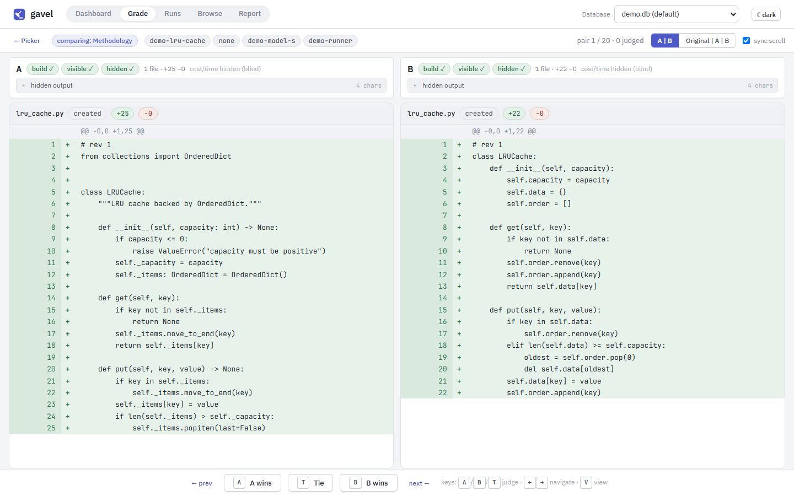
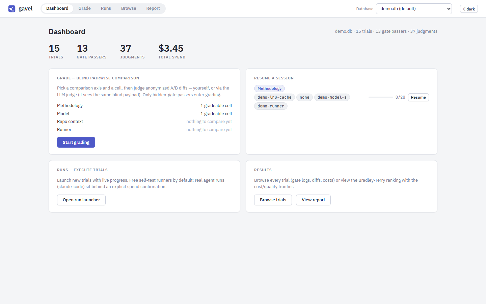

# gavel

**Find out which AI coding setup actually works best on your code, judged
blind.**

Teams adopt AI coding agents with a lot of moving parts: which model, which
instruction pack or "methodology", what project-specific guidance to give the
agent, which tool to run it in. These choices are usually made on gut feeling
and a few impressive demos. Gavel replaces that with a small, fair experiment
you run yourself on your own kind of work.



## How it works

1. **Run.** Each setup solves the same real coding tasks. Every attempt starts
   from a clean copy of the repository, so no attempt can influence another.
2. **Test.** Each attempt goes through three checks: does it build, does it pass
   the tests the agent could see, and does it pass a set of **hidden tests the
   agent never saw**? Only attempts that pass all three move on.
3. **Judge blind.** Passing solutions are shown side by side as "A" and "B",
   with everything that could reveal their origin removed: no setup names, no
   model names, no cost. You pick the one you would rather merge. An LLM judge
   can also do this, using exactly the same blind view, and gavel measures how
   often it agrees with you.
4. **Decide.** Your choices become a ranking with confidence ranges, plotted
   against cost. Gavel recommends two options: the **quality pick** for
   high-stakes work, and the **budget pick**, the cheapest option that is
   statistically as good as the winner.


## What you can compare

Change one thing, keep everything else fixed, and see whether it matters.

| You can vary… | For example |
|---|---|
| **Methodology**: a general instruction or skill pack | none (baseline), Superpowers, Karpathy guidelines, ECC, your own |
| **Repo context**: project-specific guidance for the agent | none, a hand-written guide, an exported project memory |
| **Model** | Claude Haiku, Sonnet, Opus |
| **Runner**: the tool that drives the agent | Claude Code (automated), manual (you work in your own IDE) |
| **Task**: the coding problem | 13 tasks across Python, C++, .NET and TypeScript projects |

## Try it without spending anything

You need Python 3.12+, git and Node.js 18+. On Windows:

```powershell
.\tasks.ps1 Setup                        # one-time: dependencies, task repos, web UI
python cli.py demo                       # create a sample database (no API calls)
python cli.py ui --db results-demo.db    # open http://localhost:8247
```

The demo database holds synthetic results, so you can click through blind
grading, the trial browser and the report straight away.
`python cli.py doctor` checks that everything is in place.



## Running a real comparison

Real runs call a paid model, so gavel makes spending deliberate. The browser
run-launcher shows a cost estimate and requires you to type a confirmation
before it starts anything paid. From the terminal:

```powershell
python cli.py run --task cosmos-B --methodology baseline,superpowers `
    --model claude-haiku-4-5 --reps 3 --dry-run   # preview the plan; drop --dry-run to run
```

Then grade in the web UI and produce the report with
`python cli.py report --axis methodology`.

## Design principles

- **A decision aid, not a leaderboard.** With a handful of tasks and a few
  repetitions, gavel gives you evidence for a choice, not a scientific proof.
  When the confidence ranges overlap, it says so, and the honest answer is
  "no clear difference".
- **Fair by construction.** The agent never sees the hidden tests. While judging
  you never see which setup produced a solution, nor what it cost. Unblinding a
  grading session is a deliberate, one-way step. The LLM judge sees each pair
  twice with the sides swapped, and a disagreement counts as a tie. A few repeat
  pairs are hidden in human sessions to measure how consistent you are.
- **Local first.** Everything runs on your machine, with results in a local
  SQLite file. Nothing leaves it except the model calls you explicitly start.
- **Costs from tokens.** Cost is computed from token counts and published API
  prices, so it is comparable across models and reproducible.

## Status

The full pipeline works end to end and is covered by over 500 automated tests,
plus a browser test suite that checks the blinding on the rendered page.
It has been used for three real experiments so far: 81 agent runs costing
about $36 at API prices. They compared methodologies on a .NET service and a
Python library, and project-memory variants on three personal project repositories.

## Next up

- Grade the latest project-memory experiment (24 runs, not yet judged).
- Decide per task whether hidden tests that no model passes should be eased,
  or the task reserved for stronger models.
- Collect more judgments on existing cells so the rankings tighten.

## Learn more

- [How it works](docs/how-it-works.md): axes, test gates, grading, the LLM
  judge, CLI options, task authoring.
- [Implementation plan](IMPLEMENTATION_PLAN.md): the original design and its
  rationale.
- [Writing good tasks](docs/task-design-guide.md).
- [Measurement log](docs/measurement-log.md) and
  [build history](docs/history/progress-log.md).

MIT licensed.
