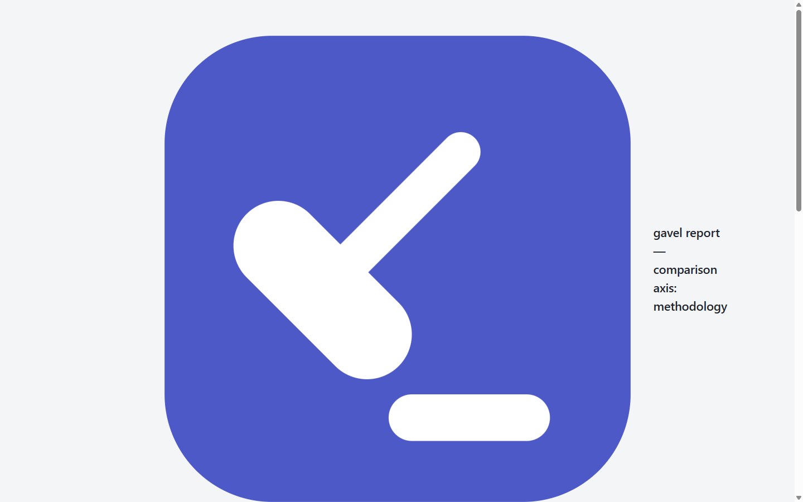

# gavel

*the strike of judgment* — formerly `setup-bench`. Created: 2026-06-20.

A local-first **decision-support tool** for comparing agentic coding setups. It
tells you which combination of methodology, repo-context, model, and runner
produces the best results for *your* tasks — and at what cost. Blind A/B
contests between anonymized solutions are judged either **by you** (the
double-blind manual mode) or **by an LLM judge** (a second, clearly separated
mode that sees exactly the same blind payload); gavel tallies the verdicts
into a Bradley-Terry ranking and reports how well the two kinds of judges
agree. It helps you make an informed choice; it does not try to prove one
setup is statistically superior.

> This is a decision-support tool with a handful of tasks and limited statistical
> power. Treat its rankings as evidence for a decision, not as theorems.

## What it is

Five independent, swappable axes. You vary one to compare it; you hold the rest
fixed.

| Axis | What it is | Example values |
|------|-----------|----------------|
| **Task** | The coding problem to solve | `pyvrp-A`…`pyvrp-C`, `cosmos-A`, `cosmos-B`, `moreiter-A` |
| **Methodology** | General-purpose instruction / skill pack (the framework under test) | `baseline`, `superpowers`, `karpathy`, `ecc` |
| **Repo-Context** | Repo-specific instructions (held fixed or varied per experiment) | `none`, `pyvrp-instructions` |
| **Model** | The LLM model | `claude-sonnet-4-6`, `claude-opus-4-8` |
| **Runner** | The execution harness | `claude-code`, `copilot-cli` (stub), `manual` |

**Methodology vs. repo-context.** Methodology is the *general* framework being
tested (a discipline pack, a skills library). Repo-context is *repo-specific*
knowledge (how this codebase is laid out, its conventions). They are separate
axes so you can test each in isolation or in combination. In the worktree they
are laid down sequentially — repo-context first, methodology on top, never merged.
Repo-contexts carry a `task_affinity` tag so nonsensical task/context pairings are
skipped by default (override with `--full-matrix`).

**Comparison is axis-general.** Every axis is a comparison target. At grade time
you pick *which* axis to compare; that axis varies while every other axis is
pinned to one "cell", and **all** axis ids are redacted from the diffs — so blind
A/B works no matter which axis you're comparing.

### Three-tier gate scorecard

Each trial gets a scorecard. The hidden gate is the definitive quality metric;
only its passers enter grading.

| Tier | Gate | Question |
|------|------|----------|
| 1 | **Compile** | Does the code build? |
| 2 | **Visible tests** | Do the tests the agent could see pass? |
| 3 | **Hidden tests** | Do the held-out tests pass? *(definitive)* |
| — | **Observational** | Whatever a task's optional `observe_cmd` asks — **recorded, never gating** |

The observational tier exists for measurements that must stay *out* of the
pass/fail decision (e.g. convention adherence): only gate-passers are gradeable,
so gating on adherence would bias the grading pool. It gets its own command
(`observe_cmd` in `task.yaml`), its own stored verdict + log
(`gate_result.observe_passed` / `observe_output`), and its own column in Browse
and in the report — and it is never served during blind comparison, since an
adherence verdict tracks the methodology axis.

### Execution flow

```
   matrix expand            fresh git worktree           gate (outside worktree)
 Task × Methodology  ──►   repo-context + methodology  ──►  compile → visible → hidden
   × Context × Model        agent runs the task              │
   × Runner × Rep                                            ▼
                                                      hidden-gate passers
                                                            │
                                                            ▼
                                              blind pairwise grading  ──►  Bradley-Terry
                                              (pick axis, pin a cell)       scores + CIs
```

**Isolated execution.** Every trial runs in a fresh `git worktree`. Held-out
tests live *outside* the worktree and are copied in only at gate time, then
removed — test leakage is impossible by construction (a leakage scanner enforces it).

**Blind pairwise grading + Bradley-Terry.** Pick the comparison axis and pin the
other axes to one cell — the UI offers an axis picker plus cascading cell pickers.
Anonymized diffs (every axis id redacted) are shown side by side; you pick A, B,
or Tie. Judgments feed a Bradley-Terry model that produces Elo-style scores with
95% bootstrap confidence intervals, ranking the chosen axis's values. Multi-rep
sampling draws balanced cross-value pairs from *all* repetitions, not just one.

**Two grading modes.** Every gradeable cell offers *Grade myself* (the blind
manual flow) or *LLM judge* — an automated judge that receives **exactly the
blind payload a human sees** (anonymized diffs + gate scorecard; never axis
ids, cost, tokens, or timing) and returns rubric-anchored verdicts as strict
JSON. Position bias is controlled by judging each pair twice with the sides
swapped; if the passes disagree the pair scores a tie. Judge providers:

| Provider | Auth | Billing |
|----------|------|---------|
| `claude-cli` (default) | your installed `claude` CLI login — a Claude Pro/Max **subscription needs no API key** | subscription quota (est. shown at API rates) |
| `gh-models` | any GitHub token (`GITHUB_TOKEN` / `gh auth login`) — free tier, or an **org/enterprise** paid tier for higher limits | metered by GitHub |
| `mock` | none | free — deterministic, for demos/tests |

Non-free providers require typing **JUDGE** after a per-session call/token
estimate. Human and LLM verdicts are never mixed inside one session; the
report can rank by *all / human / LLM* judgments and shows a **human ↔ LLM
agreement** card (raw rate + Cohen's κ) wherever both graded the same pairs —
so you can calibrate how much to trust the judge before letting it scale your
grading. Rationales and judge spend appear only after the reveal.

**API-rate cost.** Cost is computed from token counts × published API rates (a
data-driven table in `cost/pricing.toml`, refreshable via `python cli.py
pricing fetch`), not from self-reported numbers — so it's reproducible and comparable
across models. Wall-clock time is captured as a secondary metric.

**Analyzer flags.** The analyzer automatically surfaces non-discriminating tasks
(everything passes or everything fails), flaky tasks (high variance across reps),
and cost/quality tradeoffs (an expensive methodology with no quality gain).

The full design — architecture, phasing, run protocol, decision rule — lives in
`IMPLEMENTATION_PLAN.md`. Guidance on writing discriminative tasks is in
`docs/task-design-guide.md`.

## Quickstart

Prerequisites: Python 3.12+, git, and Node.js 18+ (the web UI is built once
during setup; `doctor` checks all three).

```powershell
git clone <this-repo> gavel && cd gavel
.\tasks.ps1 Setup     # venv + deps + clone task repos + rebuild task bases + build web UI + doctor
.\tasks.ps1 Ui        # open the web UI → http://localhost:8247
```

`Setup` runs `python cli.py setup`, which makes a fresh clone fully runnable:
it clones the task repos, **deterministically rebuilds the synthesized task
base commits** (see `tasks/_repo_setup/repos.lock.yaml` — same sha on every
machine), vendors the methodology packs, and builds the web UI
(`ui/frontend`, npm install + build — local only, no accounts or cloud).
`python cli.py doctor` then prints a green/red readiness table (git,
node/npm, web UI build, claude CLI, dotnet, WSL, bases, vendor packs,
pricing).

**The web UI is the single entry point**: a dashboard linking blind pairwise
grading (with resume), a run launcher with live progress (free self-test
runners by default; paid runs require an explicit typed confirmation plus a
cost estimate), a trial browser with full gate logs and costs, and the
Bradley-Terry ranking report. A database switcher in the top bar moves
between `results.db`, the demo DB, and any scratch DBs. Light and dark
themes ship, all assets are local (no network at runtime), and the design
system (the "Gavel" tokens) lives in `ui/frontend/src/tokens.css`.

Want to see the tool before spending a cent? Seed the synthetic demo:

```powershell
python cli.py demo                    # builds results-demo.db (zero API spend)
python cli.py ui --db results-demo.db # dashboard → grading, browse, report
```

## How to run it

```powershell
.\tasks.ps1 Ui        # web UI: dashboard, grading, run launcher, browse, report
.\tasks.ps1 Run       # execute trials from the terminal (passes args to `cli.py run`)
.\tasks.ps1 Grade     # web UI landing on the grading picker (alias)
.\tasks.ps1 Report    # rank an axis: BT scores + CIs, cost, Pareto frontier
.\tasks.ps1 Watch     # run tests on every file change
```

Under the hood these call `cli.py`. The main options:

```bash
python cli.py run --task all --methodology all --repo-context all \
    --model claude-sonnet-4-6 --reps 3 --dry-run
```

- `--task / --methodology / --repo-context` — an id, comma-separated ids, or `all`
- `--model` — comma-separated model ids (required)
- `--runner` — execution harness (default `claude-code`)
- `--reps` — repetitions per cell (default 3)
- `--full-matrix` — ignore `task_affinity` and run every task/context pairing
- `--dry-run` — print the trial grid and exit
- `--delay` — seconds between trials (rate limiting)

After grading, `python cli.py report --axis methodology` prints the
Bradley-Terry ranking (Elo + bootstrap CIs), three-tier gate pass rates, the
cost rollup, analyzer flags, and the two stakes-based picks — and writes a
self-contained HTML artifact under `reports/` with the quality-vs-cost Pareto
frontier:



Manage the pricing table with `python cli.py pricing list|fetch|add`.

**Per-task toolchains.** `moreiter-A` runs anywhere Python does — start there
if you have neither WSL nor the dotnet SDK. `cosmos-*` needs the .NET 8 SDK.

**WSL required for PyVRP tasks.** PyVRP's C++ doesn't compile under MSVC, so the
`pyvrp-*` tasks build under WSL (Ubuntu). `cli.py run` handles this automatically:
when a task is an editable `pip install -e .` and we're on Windows, the gate
dispatches its build/test commands into WSL (`wsl -d <distro> -- bash -lc 'source
<venv> && cd "$(wslpath -a …)" && …'`). Cosmos/.NET tasks stay on the Windows
shell. Override the distro/venv with `SB_WSL_DISTRO` (default `Ubuntu`) and
`SB_WSL_VENV` (default `~/pyvrp-venv/bin/activate`).

The standalone task validator is not WSL-aware, so run it *inside* WSL:

```bash
wsl -d Ubuntu -- bash -c 'source ~/pyvrp-venv/bin/activate && \
  cd /mnt/c/Users/norri/studio/setup-bench && \
  python scripts/validate_tasks.py --verbose --skip-toolchain-check'
```

Claude Code CLI version used: 2.1.198

### Task fields & visible-test composition

A task lives in `tasks/<id>/task.yaml`. Beyond the required fields (`id`,
`repo_url`, `base_commit`, `instruction`, `run_cmd`, `held_out_tests_path`,
`reference_diff_path`, `build_cmd`), two fields control the **visible** tier (tier
2 of the gate — the tests the agent is allowed to see):

- `visible_test_cmd` — the command run for the visible tier.
- `visible_tests_path` — a directory of EXTRA visible test files this task injects
  into the worktree (committed before the repo-context/methodology commits, so
  they're visible to the model but never appear in its diff).

A task may also declare `observe_cmd`: an observational command whose exit code
and output are recorded on the scorecard but never gate. Use it instead of
smuggling extra checks through `run_cmd` — `run_cmd`'s exit code IS the hidden
gate, so anything non-functional folded into it would decide who is gradeable.

A **repo** can also declare a default visible suite once, instead of every task
repeating it. `repos.yaml` at the project root maps a repo id to its defaults:

```yaml
cosmos:
  visible_test_cmd: 'dotnet test tests/CleanArchitectureCosmosDB.UnitTests/CleanArchitectureCosmosDB.UnitTests.csproj'
```

Presence of the key IS the opt-in. `repos.yaml` lives at the project root on
purpose — never inside `repos/<repo>`, where it would leak into every worktree
and become visible to the model. The effective `visible_test_cmd` resolves as:

| `visible_test_cmd` in task.yaml | Effective visible tier |
|---|---|
| an explicit string | that string (task overrides the repo) |
| `null` / unset | the repo's `repos.yaml` cmd if it declares one, else none |
| `none` (sentinel) | none — force-skip even if the repo declares a suite |

`scripts/validate_tasks.py --validate-transitions` now also asserts the *resolved*
visible suite is green on the clean base commit (skipped when it resolves to none),
so a declared suite can't be one that doesn't build/pass.

> **Guardrail:** task-supplied visible tests must NOT duplicate the held-out
> oracle. Visible tests that ARE the hidden tests let the model trivially satisfy
> the gate. The gate already asserts held-out files aren't pre-present in the
> worktree; keep that assertion.

#### Held-out-path collision (agent writes a test where the oracle lives)

An agent can naturally create a test at a path the held-out oracle also occupies
(on the cosmos-A shakedown, opus wrote `tests/.../Mappers/AuditMapperTest.cs`).
The gate now handles this **provenance-aware**, SWE-bench style: the oracle always
wins, but only a *genuine* leak stays fatal.

**How provenance is determined.** The runner records the post-prepare, pre-agent
HEAD as a worktree-local ref (`refs/worktree/setup-bench-baseline`, see
`grading.gate.BASELINE_REF`). At gate time, for a colliding held-out path:

- **Present in the baseline tree** (came in via a setup commit — repo-context /
  methodology / visible-tests) → *setup* provenance → **genuine leak, fatal.** The
  model would have seen the oracle. The assertion still fires.
- **Present only in the agent's diff** (not in the baseline — the agent never saw
  the oracle, which lives outside the worktree until now) → *agent* provenance →
  **not a leak.** The gate overwrites the path with the true oracle and runs that;
  the agent's own content already survives in the captured diff for blind grading.
- **No baseline ref** (nop / oracle / manual don't record one) → provenance is
  unprovable → **fatal**, exactly as before. We only relax where provenance is
  proven.

This keeps the protected invariant intact — *the model never sees the oracle, and
the gate runs the true oracle* — while no longer failing an agent that merely
guessed the same test path. The overwritten agent file is restored after the run
(leave-no-trace), mirroring the oracle-file cleanup.

## Current state

The full pipeline is built and tested (464 fast tests green plus a 24-test
Playwright UI suite behind the `integration` marker, 1 env-gated test
deselected) — engine, 5-axis matrix, three-tier gate, axis-general blind
grading in **two modes** (manual double-blind and LLM judge), Bradley-Terry
ranking, API-rate cost, the report command with the quality-vs-cost Pareto
frontier, and task-quality tooling. The task set spans two repos/languages
(PyVRP C++/Python and a .NET Cosmos DB service).

**LLM-judge mode (2026-07-06).** A second grading mode judges blind pairs
automatically: provider seam (`grading/judge_providers.py`) with `claude-cli`
(subscription, no API key), `gh-models` (GitHub free/org/enterprise), and a
deterministic zero-spend `mock`; position-swapped double passes with
disagreement→tie; strict-JSON verdicts with a self-correction retry loop; a
`judge_call` usage-audit table; typed `JUDGE` spend gate; blind progress page;
reveal enriched with rationales, swap-consistency, and judge spend; report
grader filter + human↔LLM agreement (Cohen's κ). Design notes in
`docs/superpowers/specs/2026-07-06-llm-judge-design.md`.

**Judge-mode adversarial hardening (2026-07-07).** A dedicated critic session
stress-tested the mode across blinding, parsing, races, migration, stats,
cost, and UX (commits `judge-critic-pass-1…7`): the task instruction now goes
through the same redaction as diffs, BlindingError fails closed without
naming the leaked id, hostile provider replies (NaN confidence, non-dict
rubric, 100KB prose) degrade into the retry loop instead of killing runs,
failed pairs still land their billed calls in the `judge_call` audit, a
reveal racing an in-flight provider call discards the verdict, claude-cli
usage is recorded honestly (cache-creation tokens + the CLI's own cost — a
one-shot `claude -p` call parks ~24k prompt-side tokens in cache), plan
estimates are measured per provider, and diff-budget truncation persists to
the judgment row and reveal. One bounded real run (cosmos-B model axis,
claude-haiku-4-5, 6 calls, 3/3 swap-consistent, rationales verified against
the diffs) is written up in the design doc's testing section.

**Consistency probes (E2.1, 2026-08-01).** Human grading sessions now measure
the judge as well as the contenders: session construction inserts ~10% (min 2)
deliberate repeat pairs with sides swapped, placed after their originals at
random positions (`grading/pairwise.insert_probes`). Probes are
indistinguishable on every blind surface (Playwright-asserted); their verdicts
are stamped (`judgment.is_probe`), excluded from Bradley-Terry and win/loss
summaries, and yield two instrument numbers — self-agreement and side-swap
flip rate — at reveal, in the report UI/CLI, and in the HTML artifact. Schema
changes are additive (`grading_session.probe_of`); legacy sessions and
LLM-judge sessions (which already measure consistency via position-swapped
double passes) are unaffected.

**Blinding-leak fix (2026-08-02).** Agents sometimes *commit* their own
planning/progress artifacts, which no pack lays down and the leakage scanner
therefore never sees — yet a `.agent-plans/` folder in a served diff names the
methodology on sight. The single serve-side stripper
(`grading.pairwise.METHODOLOGY_DIR_PREFIXES`, which governs blind diffs, the
diff-shape proxy and the reconstructed-originals endpoint) now drops it at any
depth, covering recorded and future runs without touching the frozen packs or
the runner's diff capture.

**A fresh clone is fully reproducible.** Task base commits are locally
synthesized (a task's feature reverse-applied onto a pinned upstream anchor;
for cosmos, a csproj/sln-only net8 migration patch) and are rebuilt by
`python cli.py setup` with pure git plumbing under fixed metadata — every
machine derives the same base shas, locked in
`tasks/_repo_setup/repos.lock.yaml`. All five tasks re-validate on the
rebuilt bases: oracle PASS / nop FAIL (pyvrp via WSL, cosmos via dotnet 8).

**The whole decision loop has run end-to-end.** The web UI carries a
committed Playwright regression suite (`pytest -m integration
tests/test_ui_playwright.py` after `python -m playwright install chromium`):
measured pane-width equality, line-number/scroll tracking, three-way view
alignment, per-axis blinding on the rendered page, an 18-pair keyboard
marathon with a mid-session reload, and the paid-runner spend gate. The
grading flow was also shaken out on both the synthetic demo DB and real
pipeline data: four
manual-runner cosmos-B trials (two hand-authored solution variants) passed
the hidden gate, were graded blind through the UI — with blinding verified on
the served diffs — and produced a Bradley-Terry ranking and report, at zero
API cost. A minimal real sweep (cosmos-A × baseline/karpathy ×
claude-haiku-4-5 × 2 reps, $1.23 total) exercised the claude-code runner,
per-methodology lay-down, the gate tiers, token-priced cost capture, and the
retry-on-transient-failure path against the live CLI. Hidden-gate passes:
0/3 — cosmos-A remains uncalibrated for haiku (a known, measured gap; see
Next up).

That shakedown also caught and fixed a founder bug: the grading UI's diff
panes had never rendered (wrong diff2html global — blank panes by
construction, invisible until gradeable data existed). Sessions are now
persisted (rankings survive a server restart), judgments are
latest-wins-per-pair (re-grading can't double-weight Bradley-Terry), diff
blinding matches whole tokens without mangling identifiers, and errored-but-
billed trials are counted in the run-summary cost total.

**Engine & tasks (P0–P1)**
- Core engine: models, DB, worktree isolation, runners, gate, leakage scanner.
- Runners: `claude-code` (headless) and `manual` (human-in-IDE), plus
  `oracle`/`nop` for pipeline self-tests. `copilot-cli` stays a stub — the
  Phase-1.5 spike (P2.1/P2.2) is **deferred** (Copilot out of scope for now; see
  Next up).
- Tasks: three cross-layer PyVRP features (`pyvrp-A` ReplaceGroup operator,
  `pyvrp-B` unary-operator framework, `pyvrp-C` PiecewiseLinearFunction) plus two
  .NET 8 Clean-Architecture/Cosmos DB tasks — `cosmos-A` (refactor: replace
  AutoMapper with hand-written mappers for the ToDoItem + Audit aggregates) and
  `cosmos-B` (feature: add a complete/reopen lifecycle across domain → MediatR
  handlers → controller, plus an `isCompleted` search filter) — each with a
  reference diff and held-out tests; oracle/nop validation passing.
- Validator is repo/language-agnostic: it runs each task's own `build_cmd`/
  `run_cmd` (PyVRP `pip install -e .`, Cosmos `dotnet build`/`dotnet test`),
  resolves the repo via an explicit `repo:` field, and lints C# as well as
  Python held-out tests.
- Methodologies: `baseline`, `karpathy`, `superpowers`, `ecc`, `custom`
  (external packs vendored at pinned commits, frozen offline). `custom` (the
  user's own conductor/executor/validator/reviewer agents) is authored for both
  the `copilot` harness (`.github/agents/`) and the `claude-code` harness
  (`CLAUDE.md` + `.claude/agents/`, adapted from the Copilot originals).
- Matrix driver + run protocol: resumable execution, inter-trial delay, Rich live
  progress table, `--dry-run` grid.

**P3 evolution**
- **P3.2** — API-rate cost from `cost/pricing.toml` (LiteLLM-fetchable), self-
  reported cost kept as a reference value.
- **P3.3** — Repo-Context axis (matrix now 5-axis); grading made axis-general
  with an axis picker + cascading cell pickers, all axis ids redacted.
- **P3.4** — three-tier gate scorecard (compile → visible → hidden).
- **P3.5** — multi-rep sampling, Bradley-Terry ranking with bootstrap CIs, and
  the analyzer flags.
- **P3.6** — task-set quality tooling: per-task `difficulty`, `calibrate_tasks.py`
  pass-rate bands, transition validation (FAIL_TO_PASS / PASS_TO_PASS / build),
  static rubric lint (`validate_tasks.py --lint`), and the golden-task rubric in
  `docs/task-design-guide.md`.

> **DB note:** the `trial` schema gained a `repo_context_id` column with no
> migration. Delete any pre-P3.3 `results.db` before running.

## Next up

- [x] **A2/A3 measurement runs** — done 2026-07-03 ($11.71 total, 26 billed
      trials): all five methodologies and both repo-contexts ran for real on
      cosmos-A (haiku), plus a calibration slice on cosmos-B and moreiter-A.
      First real gradeable cell (cosmos-B: baseline + karpathy hidden-gate
      passers) produced and blind-graded.
- [ ] **Calibration decisions** — measured pass rates: cosmos-B 33% (in the
      30–70% band, discriminative), cosmos-A 0/17 and moreiter-A 0/3 (floor
      effect for claude-haiku-4-5). Decide per task: ease the hidden gate, or
      scope the task to stronger models. Frozen golden tasks change only with a
      human OK (`recalibration_prompts/19-M-calibration-sweep.md`).
- [ ] **Grow the real ranking** — one blind judgment exists on the real cell;
      Bradley-Terry needs ≥3 comparisons. More reps on cosmos-B (cheap:
      ~$0.11/trial) and/or your own grading session gets there. The pre-existing
      judgment lives in session `c38ed5475724451ab3bb8caedf5d2e2b` (graded by
      Claude, not you — delete that session's judgment rows if you want a pure
      human gold standard).
- [x] **Pure-Python starter task** — `moreiter-A` (more-itertools
      running-aggregates family): pip+pytest gate, no WSL, no dotnet.
      oracle=PASS / nop=FAIL on Windows; base rebuilt deterministically like
      the others.
- [~] **Phase R (Copilot) — DEFERRED (2026-07-01)** — no Copilot account/plan on
      hand. Runner axis stays coverable via the `manual` runner. Revive prompts
      11–13 if a Copilot plan appears.
- [ ] **UI/UX professionalization + rebrand** — the pipeline works but the
      grading UI reads as a hobby project: hidden picker flow, no hover
      previews, a broken diff screen (uneven split, line numbers that don't
      track scroll, no three-way original/A/B view), only three pass/fail
      badges where much more gate detail already exists in the DB, and no
      unified entry point or consistent branding across surfaces. Full prompt,
      with root causes already traced, in
      `recalibration_prompts/28-U1-ui-ux-professionalization.md` — a two-phase
      Fable session (phase 1: functional rebuild, plain styling; phase 2:
      apply a real design) with a human-run Claude Design interlude between
      the two, on a dedicated branch.
